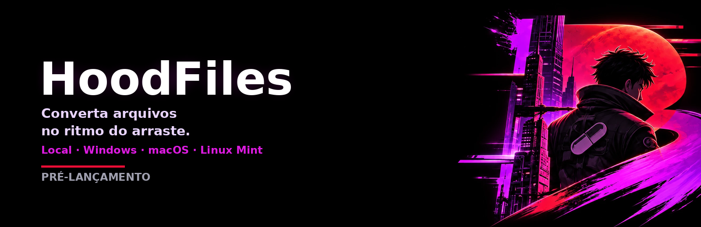
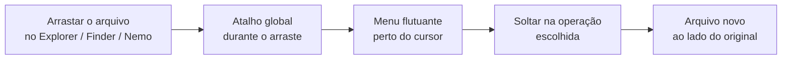
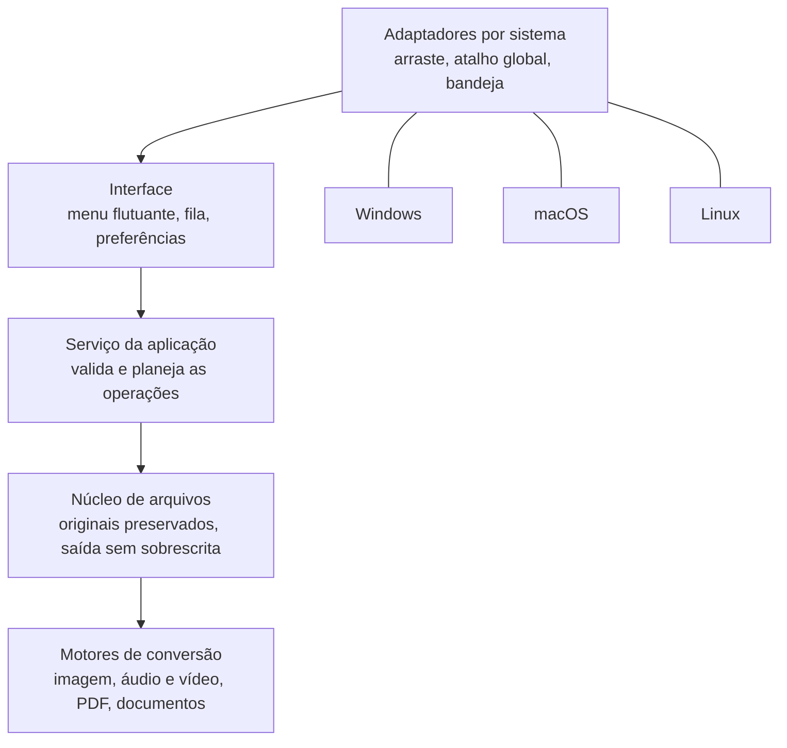

<p align="center">
  
</p>

<p align="center">
  <a href="https://github.com/michel-brotherhood/hoodfiles/actions/workflows/hf-00-poc.yml"></a>
  
  
</p>

# HoodFiles

Utilitário desktop para converter e manipular arquivos **no seu computador**, sem abrir outro programa e sem mandar nada para a internet. Feito para Windows, macOS e Linux Mint.

> **Estado atual:** o aplicativo ainda não existe. Este repositório tem a especificação, o plano de execução e a prova de interação nativa (etapa HF-00), que está sendo validada nos três sistemas. Não há instalador para baixar.

## A ideia

Você está no Explorer, no Finder ou no Nemo, segurando um arquivo. Em vez de abrir um conversor, aperta um atalho: um menu flutuante aparece perto do cursor com o que dá para fazer com *aquele* arquivo. Você solta nele e o resultado cai ao lado do original, que nunca é alterado.



O difícil é o passo do meio: acionar um atalho global **no meio de um arraste que começou em outro programa**, sem cancelá-lo. É exatamente isso que a HF-00 verifica antes de qualquer conversor ser escrito.

## Princípios

- **Local.** Sem nuvem, sem login. Nomes, caminhos e conteúdo de arquivos não saem da máquina.
- **Original intacto.** Nada é apagado nem sobrescrito em silêncio; se o nome já existe, a saída ganha outro.
- **Só opções reais.** O menu mostra apenas o que funciona para o arquivo e para o motor instalado.
- **Testado de verdade.** Compilar não é funcionar: cada sistema só conta como pronto depois que uma pessoa arrasta arquivos reais nele.

## Em que pé está

| Peça | Estado |
| --- | --- |
| Prova de interação, Windows x64 | compila e passa no CI; teste com arraste real **pendente** |
| Prova de interação, macOS Apple silicon | compila e passa no CI; teste com arraste real **pendente** |
| Prova de interação, Linux Mint (X11) | **parcial**: no Mint 22.3 o overlay abre; a captura do atalho global está em investigação |
| Aplicativo de conversão | não iniciado (depende da HF-00) |
| Site de apresentação | pronto em [`site/`](site/); publicação em definição |
| Download | em breve |

O detalhe de cada teste e as evidências estão em [`docs/status.md`](docs/status.md) e [`docs/poc-native-interaction.md`](docs/poc-native-interaction.md).

## Como vai ser por dentro



A stack candidata é **Tauri 2 + Rust**, com interface em HTML/CSS/TypeScript sem framework. A decisão final depende da prova de interação: [`docs/decisions/0001-stack.md`](docs/decisions/0001-stack.md).

## Estrutura do repositório

```text
docs/                  especificação, arquitetura, roadmap, segurança, testes, status e evidências
poc/native-interaction prova de interação nativa (Rust + Tauri) e o roteiro de teste manual
site/                  site estático de apresentação (HTML, CSS e JS, sem dependências)
design/                arte de identidade e o script que gera as imagens
.github/               workflows (CI dos pacotes de teste, deploy do site), modelos de issue e de PR
```

## Rodando a prova de interação

Requer [Rust](https://rustup.rs). No Linux, as bibliotecas do WebKitGTK; a lista está em [`poc/native-interaction/README.md`](poc/native-interaction/README.md).

```text
cd poc/native-interaction
cargo test -p hf-poc-core        # lógica portátil (máquina de estados, geometria, registro de entradas)
cargo run -p hf-poc-app          # abre a janela de diagnóstico; o atalho padrão é Ctrl+Alt+Shift+D
```

Para testar sem compilar, o CI gera pacotes de teste **sem assinatura** para os três sistemas (aba *Actions*, execução do workflow *HF-00 PoC*, seção *Artifacts*). O roteiro curto de teste manual está em [`poc/native-interaction/ROTEIRO-N03-N06.md`](poc/native-interaction/ROTEIRO-N03-N06.md).

## Documentação

| Documento | Conteúdo |
| --- | --- |
| [`docs/spec.md`](docs/spec.md) | Produto, fluxos e limites |
| [`docs/architecture.md`](docs/architecture.md) | Componentes e contratos |
| [`docs/roadmap.md`](docs/roadmap.md) | Etapas HF-00 a HF-11 e critérios de aceite |
| [`docs/formats.md`](docs/formats.md) | Operações planejadas (metas, não promessas) |
| [`docs/ux.md`](docs/ux.md) | Comportamento e qualidade da interface |
| [`docs/security.md`](docs/security.md) | Proteção dos arquivos e do computador |
| [`docs/testing.md`](docs/testing.md) | Estratégia de testes e evidências |
| [`docs/distribution.md`](docs/distribution.md) | Builds, instaladores e atualizações |
| [`docs/status.md`](docs/status.md) | Estado real do projeto |
| [`docs/site.md`](docs/site.md) | Como editar e publicar o site |

## Contribuindo

As regras de trabalho estão em [`CONTRIBUTING.md`](CONTRIBUTING.md). A ajuda mais valiosa agora é **testar a prova de interação no seu sistema**: use o modelo *Relato de teste nativo* ao abrir uma issue. Vulnerabilidades: [`SECURITY.md`](SECURITY.md).

## Licença

**Todos os direitos reservados.** O código está público apenas para consulta e teste; não é código aberto. Copiar, republicar, criar derivados, uso comercial e reutilizar o nome ou a arte exigem autorização por escrito. Veja [`LICENSE`](LICENSE).
